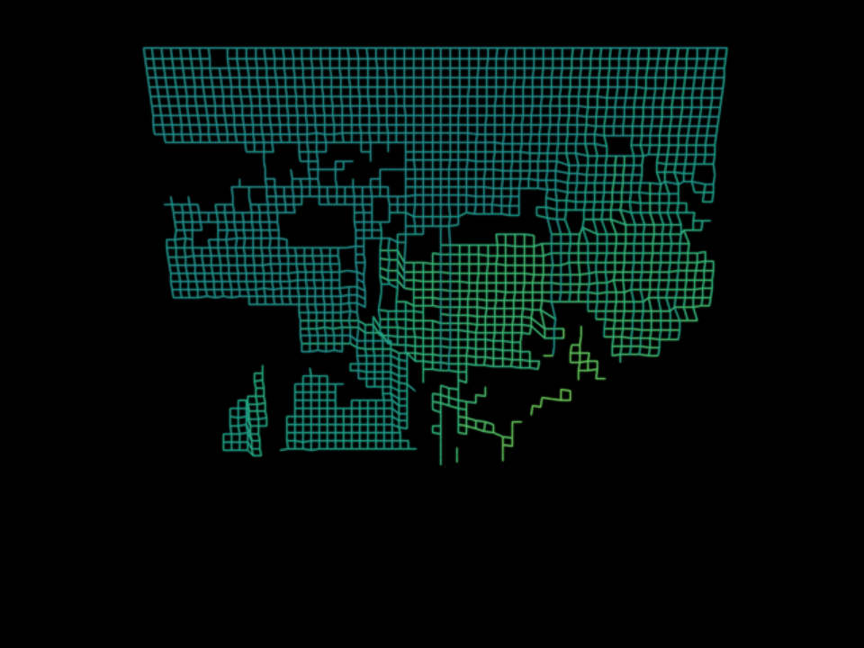
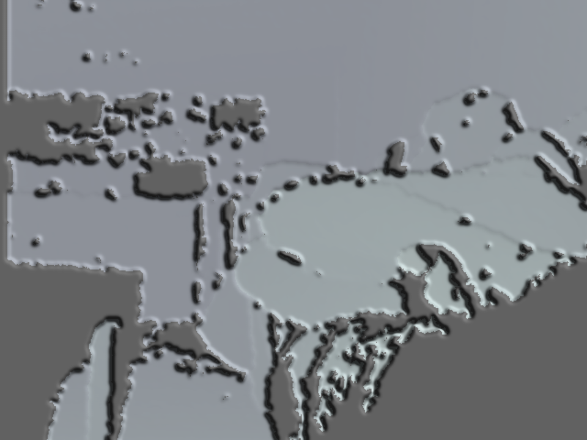

# KinectFX

Turn an **Xbox 360 Kinect (Kinect v1)** into a webcam full of TouchDesigner-style
depth effects, and pipe the result into **Discord** (or Zoom/Meet/OBS) as a
virtual camera.

Live samples from a Kinect v1 (in `docs/samples/`): Depth Mesh and Relief Light:

 

## What it does

- Reads the Kinect's **depth** map (and IR / RGB if you want them).
- Every effect is **depth-driven**, with slider controls:
  - **Point Cloud** — projects depth into a 3D point cloud you can **orbit with
    the mouse** (or Yaw/Pitch/Distance sliders + auto-spin); near/far clip drops
    the background (depth-keyed).
  - **RGB Point Cloud** — same 3D cloud, textured with the **real colour camera**.
    RGB + depth come from different sensors so they're captured together, and the
    depth is registered to the colour frame so every point gets its true colour.
  - **Depth Mesh** — the depth surface as a rotating wireframe (mouse-orbit).
  - **Relief Light** — surface normals + Lambert shading with a movable light;
    a 3D-sculpture look.
  - **Normal Map** — depth surface normals visualised as an RGB normal map.
  - **Depth Fog** — colour by distance with an atmospheric fog falloff.
  - **Scan Plane** — a bright plane sweeps through depth (LIDAR-style), or scrub
    it manually.
  - **Topographic** — quantised depth contour bands.
  - **Depth Slice** — near/far silhouette with glowing outline.
- **Mouse camera:** on 3D effects, drag the viewfinder to orbit and scroll to zoom.
- Global **brightness / contrast / trails (feedback) / mirror**.
- Modern dark Qt theme (no Swift/native code needed).
- Outputs to a **virtual camera** that Discord can use.

## Requirements

- macOS on Apple Silicon, [Homebrew](https://brew.sh).
- A Kinect v1 (model 1414/1473) + its USB/power adapter.
- OBS 30+ (installed by `setup.sh`) — provides the macOS virtual-camera backend.

## Install

```bash
./setup.sh
```

This installs `libfreenect` + `libusb`, installs OBS, creates a `.venv`, and
installs the Python deps.

> **One-time:** open OBS, click **Start Virtual Camera** once (this registers the
> macOS virtual-camera system plugin), then quit OBS.

## Run

```bash
./run.sh
```

1. Pick a **Source** (IR is the fun one) and an **Effect**.
2. Tweak the sliders.
3. Click **Start Virtual Camera**.
4. In **Discord → Settings → Voice & Video → Camera**, select **OBS Virtual Camera**.

If the Kinect or `libfreenect` isn't found, the app falls back to an animated
synthetic source so you can still explore the effects.

## How it works

- `kinectfx/kinect_source.py` — `ctypes` binding to libfreenect's `freenect_sync`
  C API (no Cython build needed). Returns IR / depth / RGB as numpy arrays.
- `kinectfx/effects.py` — effects + `Param` specs that drive the auto-generated
  sliders. Add an effect by subclassing `Effect` and appending to `EFFECTS`.
- `kinectfx/pipeline.py` — capture → normalise → effect → feedback trails → resize.
- `kinectfx/virtualcam.py` — `pyvirtualcam` wrapper (OBS backend on macOS).
- `kinectfx/app.py` — PySide6 GUI with a background capture thread.

## Troubleshooting

- **"Kinect/libfreenect not found"** — run `brew install libfreenect`; make sure
  the Kinect is plugged into power *and* USB. Try `python -m kinectfx.kinect_source`.
- **`LIBUSB_ERROR_ACCESS` / `Invalid index [0]` / `rc=-1`** — the USB device is
  wedged (usually after the app was killed uncleanly). **Unplug the Kinect's USB
  and plug it back in**, then retry. The capture layer already retries briefly to
  ride out the normal hiccup when switching sources.
- **Virtual camera won't start** — OBS must be installed and you must have started
  its virtual camera once. Discord may need a restart to see a new camera.
- **IR image is dark/grainy** — that's normal IR; bump Gain/Brightness, and note
  the IR projector dots are visible (that's the Kinect's depth pattern).
